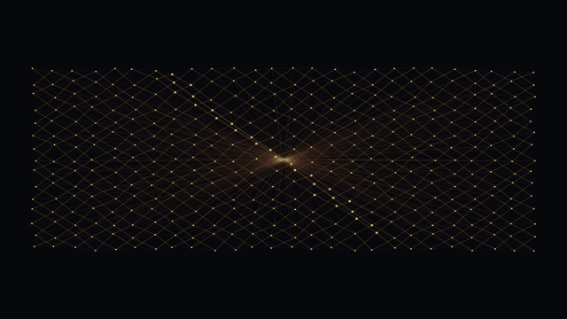
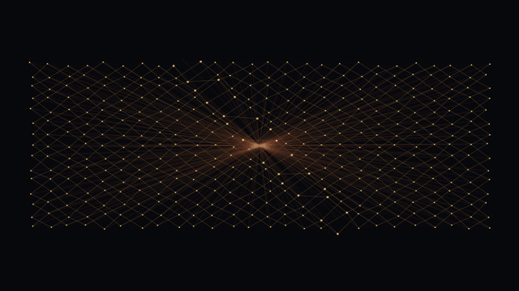
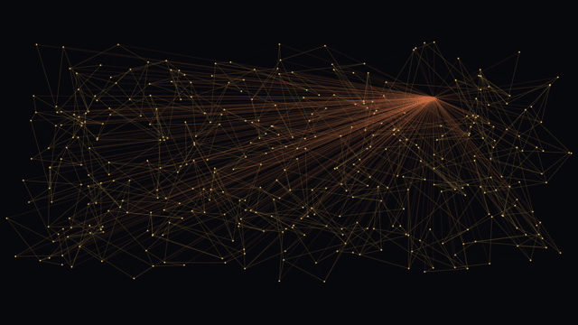
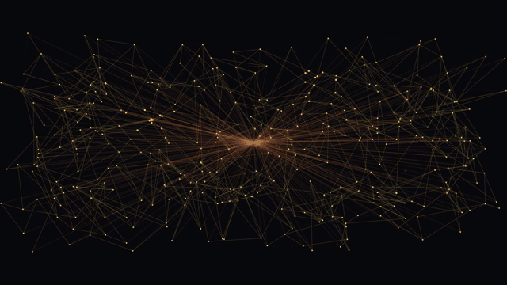
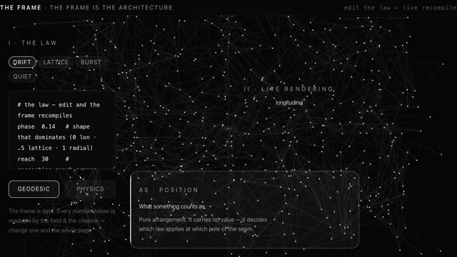
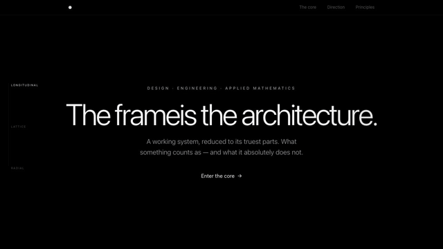

# Prima — a constraint-first widget language

Everything is either **as** something or **not_as** something. There is no third state.

Prima is not a website builder. It is not a UI framework. It is a small language with one
primitive — the frame — that describes what a thing is and what it is not, and composes
into interactive widgets:

```prima
fav_movie as string not_as digit;
score as number not_as negative;
```

Every judgment is a frame with a positive edge (`as`) and a negative edge (`not_as`).
The space between them is the **seam** — the only honest line.

This repository is the language, its runtime, and a corpus of single-file widgets that
render the frame model directly to the screen. Each one is self-contained HTML — open it
in a browser and it runs. No build step, no server, no framework.

## What it is, plainly

- A **widget creator**: the pieces in `outputs/` are the demonstration. They are not full
  websites — they are focused, single-purpose interactive artifacts built on one engine.
- A **language**: `prima.c` interprets `.prima` frames. It is deliberately small — the
  thesis is that one well-formed primitive composes into arbitrarily rich structure.
- A **design constraint**: three states (`as` / `frontier` / `not_as`) that always sum to
  unity, a cursor that conducts the phase between them. That's the entire visual language.

## Build

```sh
cc -o prima prima.c
./prima test.prima
```

A pure-C interpreter (`prima.c`, ~2k lines, no dependencies) plus a Python reference
implementation (`prima.py`). Run the test suite with `make test`.

## The frame

| primitive  | meaning                                                    |
|------------|------------------------------------------------------------|
| `as X`     | positive constraint — the value counts as X                |
| `not_as Y` | negative constraint — the value absolutely does not count as Y |

`fn[n]` selects a categorical computation from a function space; pipes (`->`) compose
frames; `for item in list {}` iterates.

## The widgets

The `outputs/` directory is a set of single-file interactive pieces built on the same
engine: one node grid, three states that always sum to unity, and a cursor that conducts
the phase between them. Open any of them in a browser — they run directly, no build step.

| widget | demo | interaction |
|--------|------|-------------|
| **metamorph** |  | the 3-mode convolution, dominance readout |
| **mirror** |  | drag to draw a mirror; the field folds onto its reflection |
| **fracture** |  | drag to cut a seam; the lattice tears open, then heals |
| **resonance** |  | click to drop a pulse source; rings wash the field |
| **gravity** |  | click to drop gravity wells; the lattice yields |
| **seam** |  | the thesis — the only honest line |
| **frame** |  | the live DSL recompiler |
| **one page** |  | monochrome discipline, scroll spine |

## License

**Dual-licensed.**

- **AGPL-3.0** — see [LICENSE](LICENSE). You may use, modify, and distribute Prima freely,
  but any work that uses it — including as a network service — must be released in full
  under AGPL-3.0.
- **Commercial** — see [COMMERCIAL_LICENSE.md](COMMERCIAL_LICENSE.md). A separate
  commercial license is available for organizations that want to use Prima in proprietary
  or closed-source products without AGPL obligations.

The code is protected. If you build on it, the source builds back.
