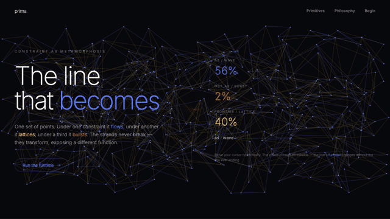
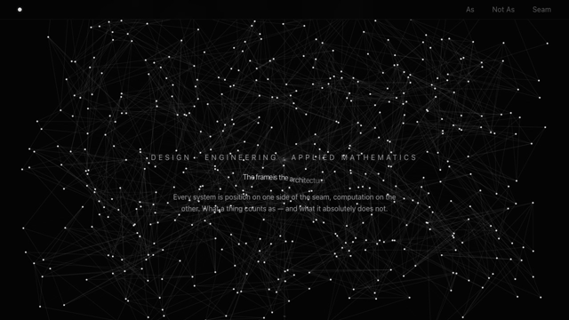

# Prima — a constraint-first widget language

Everything is either **as** something or **not_as** something. There is no third state.

Prima is a small language with one primitive — the frame — that describes what a thing is and what it is not. The space between is the **seam** — the only honest line.

```prima
fav_movie as string not_as digit;
score as number not_as negative;
```

This is the public demo site. Every file here is a self-contained widget — open it in a browser and it runs. No build step, no server, no framework.

## The widgets

The `outputs/` directory is a set of single-file interactive pieces built on one engine: three states that always sum to unity, and a cursor that conducts the phase between them.

| widget | demo | interaction |
|--------|------|-------------|
| **metamorph** |  | the 3-mode convolution, dominance readout |
| **mirror** |  | drag to draw a mirror; the field folds onto its reflection |
| **fracture** |  | drag to cut a seam; the lattice tears open, then heals |
| **resonance** |  | click to drop a pulse source; rings wash the field |
| **gravity** |  | click to drop gravity wells; the lattice yields |
| **seam** |  | the thesis — the only honest line |
| **frame** |  | the live DSL recompiler |
| **one page** |  | monochrome discipline, scroll spine |

[Explore the full gallery →](https://arshbuttar426-hue.github.io/prima/)